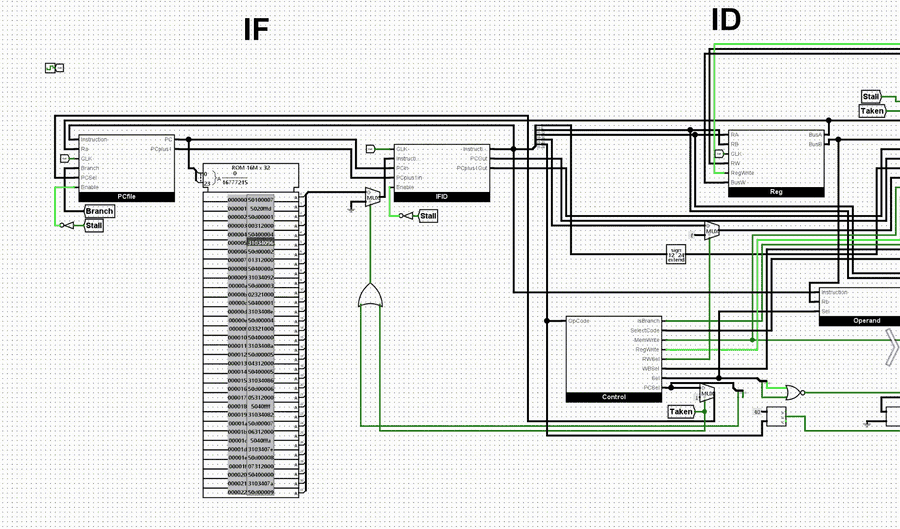
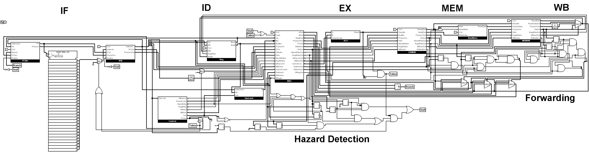
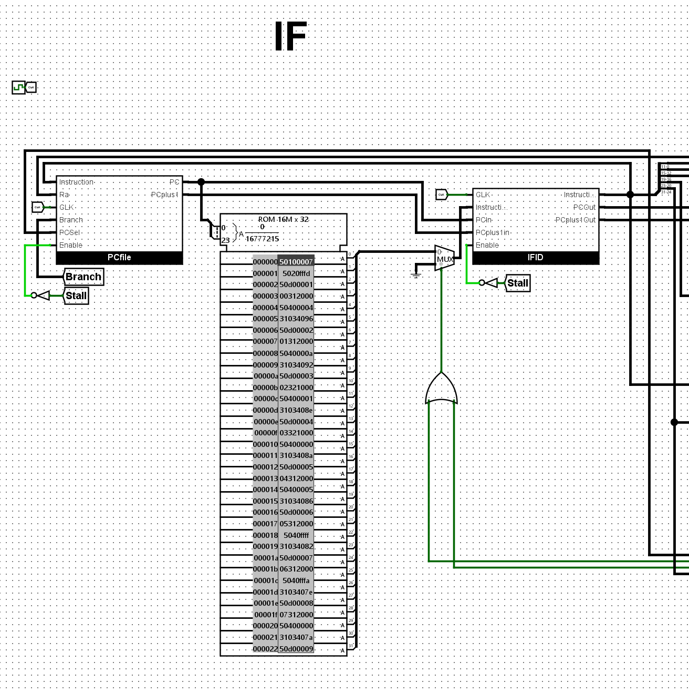
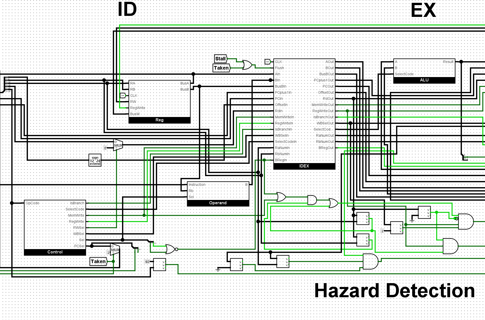
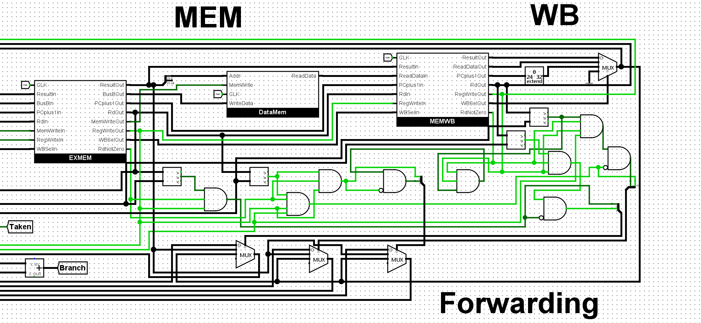

# Pipelined 32-bit RISC Processor

A 5-stage pipelined 32-bit RISC processor that I designed and built from scratch in **Logisim-evolution**. It runs a custom 26-instruction ISA and handles all three kinds of pipeline hazard in hardware: **data forwarding**, **load-use stalls**, and **branch and jump control hazards**. A self-checking suite of 32 test programs verifies every instruction and every hazard case, and **all 32 tests pass**.

I built it on my own to go beyond the 16-bit processor covered in my Computer Organization course (COE 301) at KFUPM. The instruction set follows a KFUPM COE 301 pipelined-processor project specification.



*The test suite running: the PC steps through the program in the instruction ROM and halts at the PASS loop (address 0x9A).*

## Datapath



*Click the image to view it at full size.*

## Features

- **5-stage pipeline:** Fetch (IF), Decode (ID), Execute (EX), Memory (MEM), and Write-back (WB), with pipeline registers between every stage
- **Data forwarding** from the EX/MEM and MEM/WB stages to both ALU inputs and to store data, so dependent instructions run back to back without stalling
- **Load-use hazard detection:** stalls the pipeline for exactly one cycle when an instruction needs a value that the previous LW is still loading
- **Branch handling:** branches are predicted not taken; when a branch is taken, the wrongly fetched instructions are flushed into bubbles
- **Jumps:** J, JAL, and JR resolve with a single-cycle stall
- **32-bit ALU:** add, subtract, signed and unsigned set-less-than, AND, OR, XOR, NOR, logical and arithmetic shifts, and rotate
- **Register file:** sixteen 32-bit registers (R0 is hardwired to zero), with two read ports and one write port
- **Memory:** separate word-addressed instruction and data memories, each with 2<sup>24</sup> 32-bit words, and a 24-bit program counter

## Instruction set architecture

### Registers and memory

| Item | Details |
|---|---|
| General-purpose registers | R0 to R15, 32 bits each. R0 always reads as 0 and ignores writes. |
| Link register | JAL saves the return address in R15. |
| Program counter | 24 bits, holding a **word** address. It increments by 1 per instruction. |
| Instruction memory | 2<sup>24</sup> words of 32 bits, word-addressed, program loaded at address 0 |
| Data memory | 2<sup>24</sup> words of 32 bits, word-addressed. Only whole words are loaded and stored. |

### Instruction formats

All instructions are 32 bits.

```
R-type:  | Op (8) | Rd (4) | Ra (4) | Rb (4) |   unused (12)  |
I-type:  | Op (8) | Rd (4) | Ra (4) |       Immediate (16)     |
Branch:  | Op (8) |  0 (4) | Ra (4) | Rb (4) | Immediate (12) |
J-type:  | Op (8) |             Immediate (24)                |
```

### Instructions (26)

**R-type ALU**

| Instruction | Opcode | Operation |
|---|---|---|
| ADD | 0x00 | Rd = Ra + Rb |
| SUB | 0x01 | Rd = Ra − Rb |
| SLT | 0x02 | Rd = (Ra < Rb), signed |
| SLTU | 0x03 | Rd = (Ra < Rb), unsigned |
| AND | 0x04 | Rd = Ra & Rb |
| OR | 0x05 | Rd = Ra \| Rb |
| XOR | 0x06 | Rd = Ra ^ Rb |
| NOR | 0x07 | Rd = ~(Ra \| Rb) |

**I-type ALU**

| Instruction | Opcode | Operation |
|---|---|---|
| ADDI | 0x50 | Rd = Ra + sign-extended Imm16 |
| SLTI | 0x52 | Rd = (Ra < sign-extended Imm16), signed |
| SLTIU | 0x53 | Rd = (Ra < sign-extended Imm16), unsigned |
| ANDI | 0x54 | Rd = Ra & zero-extended Imm16 |
| ORI | 0x55 | Rd = Ra \| zero-extended Imm16 |
| XORI | 0x56 | Rd = Ra ^ zero-extended Imm16 |
| SLL | 0x58 | Rd = Ra << Imm5 (shift left logical) |
| SRL | 0x59 | Rd = Ra >> Imm5 (shift right logical) |
| SRA | 0x5A | Rd = Ra >> Imm5 (shift right arithmetic) |
| ROR | 0x5B | Rd = Ra rotated right by Imm5 |
| LUI | 0x5C | Rd = Imm16 << 16 (load upper immediate) |

Shifts and rotate use the lower 5 bits of the immediate. LUI followed by ORI loads any 32-bit constant.

**Memory**

| Instruction | Opcode | Operation |
|---|---|---|
| LW | 0x10 | Rd = Mem[Ra + sign-extended Imm12] |
| SW | 0x20 | Mem[Ra + sign-extended Imm12] = Rb |

**Branches and jumps**

| Instruction | Opcode | Operation |
|---|---|---|
| BEQ | 0x30 | if (Ra == Rb) PC = PC + sign-extended Imm12 |
| BNE | 0x31 | if (Ra != Rb) PC = PC + sign-extended Imm12 |
| JR | 0x40 | PC = lower 24 bits of Ra |
| J | 0x60 | PC = Imm24 |
| JAL | 0x61 | R15 = PC + 1, PC = Imm24 |

Branches are PC-relative: the offset is added to the branch instruction's own address. J and JAL use direct addressing. All other opcodes are treated as no-ops.

## Pipeline design

| Stage | What happens |
|---|---|
| **IF** | The PC addresses the instruction ROM. The next PC is chosen from PC + 1, a branch target, or a jump target. |
| **ID** | Instruction decoding, register file read, immediate sign extension, and control signal generation. Hazard detection checks for load-use dependencies here. |
| **EX** | The ALU operates on forwarded or register operands. Branch conditions and targets are resolved. |
| **MEM** | Loads and stores access data memory. |
| **WB** | The ALU result, loaded data, or return address is written back to the register file. |

**Hazard handling:**

| Hazard | Solution |
|---|---|
| Data dependency between nearby instructions | Forwarding from EX/MEM (newest value takes priority) and from MEM/WB |
| Load followed by an instruction that uses the loaded value | Hazard detection stalls the PC and IF/ID for one cycle and inserts a bubble into ID/EX |
| Taken branch | Instructions fetched after the branch are flushed into bubbles |
| Jump (J, JAL, JR) | One-cycle stall |

## Close-ups

**Fetch (IF):** PC logic, instruction ROM (with the test program loaded), and the IF/ID pipeline register



**Decode, execute, and hazard detection (ID / EX):** register file, control unit, ID/EX pipeline register, ALU, and the stall and flush logic



**Memory, write-back, and forwarding (MEM / WB):** data memory, EX/MEM and MEM/WB pipeline registers, and the forwarding unit that routes results back to the ALU



## Test program

`test_program.asm` is a self-checking test suite of **32 tests** (160 instructions). Each test computes a result into R3, loads the expected value into R4, and branches to a FAIL routine if they differ. If every test passes, the program halts in a PASS loop.

**Result: all 32 tests pass on the Logisim design.**

| Tests | What they check |
|---|---|
| 1–8 | Every R-type instruction, including signed vs. unsigned comparison |
| 9–19 | Every I-type instruction, including sign-extended vs. zero-extended immediates, shifts, rotate, and LUI |
| 20 | Writes to R0 are ignored |
| 21–24 | Forwarding: from EX/MEM, from MEM/WB, both operands from different stages at once, and the newest value winning when a register is written twice in a row |
| 25–27 | Loads and stores, the load-use stall, base + displacement addressing, and a load feeding a store |
| 28–30 | Branches not taken, taken branches flushing wrong-path instructions, and a branch comparing a just-computed register |
| 31–32 | J, JAL, and JR, including checking the return address saved in R15 |

### Reading the result

| Outcome | R14 | Data memory [0] | R13 | PC halts at |
|---|---|---|---|---|
| **All tests pass** | `0x600D` | `0x600D` | 32 | `0x9A` |
| **A test fails** | `0x0BAD` | `0x0BAD` | number of the failed test | `0x9D` |

A failure points straight to the broken feature. For example, R13 = 25 would mean the load-use stall needs fixing.

## How to run it

1. Open `processor.circ` in **Logisim-evolution 3.8.0**.
2. Right-click the instruction memory (ROM) and choose **Load Image**, then select `test_program.hex`.
3. Reset the simulation (**Simulate → Reset Simulation**, Ctrl+R), then turn on auto-ticking (Ctrl+K) or step the clock manually.
4. When the PC stops changing, check R14 in the register file: `0x600D` means every test passed.

## Example program

`examples/array_sum.asm` stores the array [10, 20, 30, 40, 50] in memory, calls a procedure with JAL to sum it, and returns 150 in R3. It's a short, realistic program showing a procedure call and a loop running on the pipeline. When it finishes, R3 and R7 both hold 150 (0x96).

## Files

| File | Description |
|---|---|
| `processor.circ` | Logisim-evolution design (top-level datapath and all subcircuits) |
| `test_program.asm` | Self-checking test suite, with addresses, machine code, and comments |
| `test_program.hex` | Test suite image to load into the instruction ROM |
| `examples/` | Array-sum example program (`.asm` and `.hex`) |
| `docs/` | Datapath images and demo |
